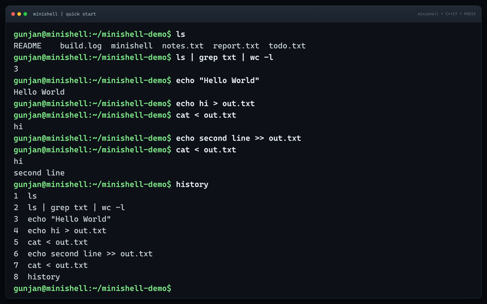
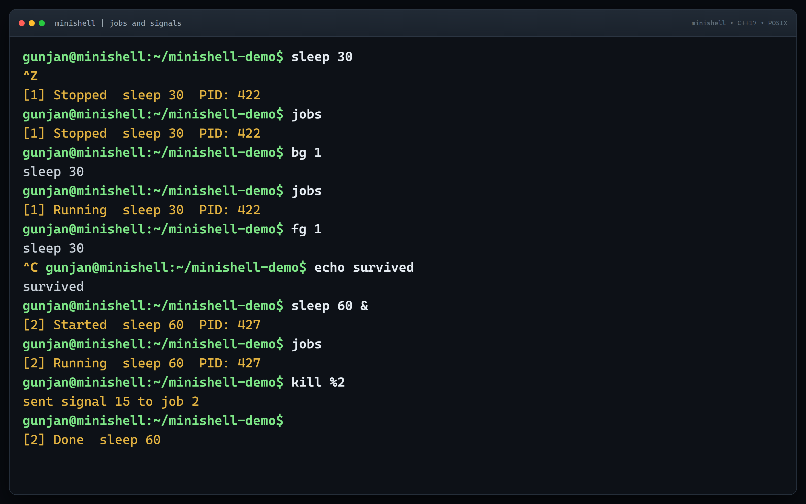
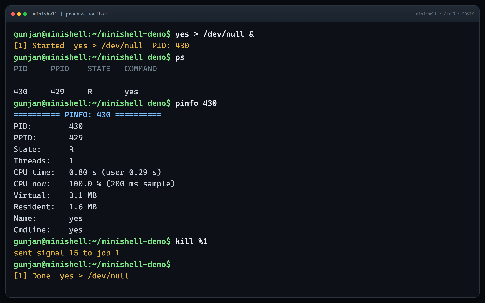
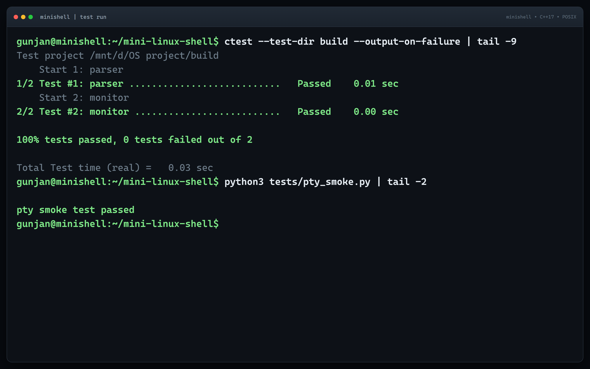

# Mini Linux Shell with Process Manager

[](https://github.com/Gunjan00001/Mini-Linux-Shell-with-Process-Manager/actions/workflows/ci.yml)

A small Linux shell written in C++17 that implements the interesting parts of a
shell itself: `fork`, `execvp`, `waitpid`, pipes, `dup2` redirection, terminal
job control with process groups, `SIGCHLD` reaping through a self-pipe, and a
process monitor that reads the Linux `/proc` filesystem.

It is a teaching-grade shell, not a bash replacement. The goal is to show every
mechanism instead of hiding it behind a library.

Latest tagged release: [`v1.1.2`](https://github.com/Gunjan00001/Mini-Linux-Shell-with-Process-Manager/releases/tag/v1.1.2).

## Screenshots

Real sessions captured through a pseudo terminal while the shell was running:

| Quick start | Jobs and signals |
|---|---|
|  |  |

| Process monitor | Test run |
|---|---|
|  |  |

```text
gunjan@minishell:~$ ls | grep txt
notes.txt
gunjan@minishell:~$ sleep 30 &
[1] Started  sleep 30  PID: 4210
gunjan@minishell:~$ jobs
[1] Running  sleep 30  PID: 4210
gunjan@minishell:~$ monitor --pid 4210
========== PROCESS INFO: 4210 ==========
PID:        4210
PPID:       4000
State:      S
Threads:    1
CPU time:   0.02 s (user 0.00 s)
CPU now:    0.0 % (200 ms sample)
Virtual:    2.3 MB
Resident:   1.1 MB
Name:       sleep
Cmdline:    sleep 30
```

## Features

| Area | What works |
|---|---|
| Execution | external programs via `execvp`, argument list, single/double quotes |
| Builtins | `cd`, `pwd`, `exit`, `jobs`, `history`, `kill`, `fg`, `bg`, `ps`, `pinfo`, `monitor`, `help` |
| Pipelines | any number of stages: `a \| b \| c` |
| Redirection | `< input`, `> output`, `>> output` |
| Background | `command &`, job ids, `[n] Done` notices at the prompt |
| Job control | per-job process groups, terminal handoff (`tcsetpgrp`), Ctrl+C, Ctrl+Z, `fg`, `bg` |
| Signals | `SIGCHLD` via self-pipe, the shell survives Ctrl+C, children are reaped |
| Monitoring | `monitor`, `monitor --pid N`, `ps`, `pinfo N` from `/proc/[pid]/stat`, `/proc/[pid]/cmdline`, `/proc/meminfo`, `/proc/uptime` |
| History | `history`, `!N` to re-run entry N |

## Requirements

- **Linux** (Ubuntu 22.04+, Debian 12+, Fedora, Arch — any modern distro).
- A C++17 compiler (`g++` 9+ or `clang++` 10+), CMake 3.16+, and `git`.
- Windows: run everything inside **WSL2** — the shell needs Linux system calls.
  PowerShell:
  ```powershell
  wsl --install -d Ubuntu
  ```
  Then open Ubuntu and follow the Linux instructions.
- macOS: **not supported** (no `fork`/`waitpid`/`/proc` semantics). Use a VM,
  container, or remote Linux box.

## Install

### Option A — one command (recommended)

```bash
curl -fsSL https://raw.githubusercontent.com/Gunjan00001/Mini-Linux-Shell-with-Process-Manager/main/install.sh | bash
```

The script clones into `~/.local/src/mini-linux-shell`, builds it, and installs
`~/.local/bin/minishell`. No `sudo`, nothing outside your home directory.
Afterwards, add `~/.local/bin` to `PATH` if the script tells you to, then:

```bash
minishell
```

`wget` works the same way:

```bash
wget -qO- https://raw.githubusercontent.com/Gunjan00001/Mini-Linux-Shell-with-Process-Manager/main/install.sh | bash
```

### Option B — prebuilt binary

Download `minishell-linux-x86_64` from
[Releases](https://github.com/Gunjan00001/Mini-Linux-Shell-with-Process-Manager/releases),
then:

```bash
curl -fL -o minishell \
  https://github.com/Gunjan00001/Mini-Linux-Shell-with-Process-Manager/releases/latest/download/minishell-linux-x86_64
chmod +x minishell
mv minishell ~/.local/bin/    # or anywhere on your PATH
minishell
```

### Option C — build from source

```bash
git clone https://github.com/Gunjan00001/Mini-Linux-Shell-with-Process-Manager.git
cd Mini-Linux-Shell-with-Process-Manager
cmake -S . -B build -DCMAKE_BUILD_TYPE=Release
cmake --build build -j
./build/minishell
```

### Uninstall

```bash
curl -fsSL https://raw.githubusercontent.com/Gunjan00001/Mini-Linux-Shell-with-Process-Manager/main/install.sh | bash -s -- --uninstall
```

That removes `~/.local/bin/minishell` and `~/.local/src/mini-linux-shell`.
For a manual checkout, `rm -rf` the clone.

> **Why not npm / pip / brew?** This is a compiled Linux binary using POSIX
> system calls directly, not a script or a library in those ecosystems. A
> package manager entry would add nothing over the one-liner above. See
> [docs/faq.md](docs/faq.md).

## Quick start (first 60 seconds)

```bash
minishell            # start it
pwd                  # where am I
ls | head -5         # a pipeline
echo hi > /tmp/x     # redirection
cat < /tmp/x
sleep 30 &           # background job
jobs                 # see it
monitor --pid $$     # detailed /proc view of this shell
help                 # list builtins
exit
```

## Usage

### Command lines

| Syntax | Meaning | Example |
|---|---|---|
| `cmd arg arg` | run a program | `ls -la /tmp` |
| `"..."` / `'...'` | one argument, spaces included | `echo "Hello World"` |
| `a \| b \| c` | pipelines, stdout to stdin | `ls \| grep txt \| wc -l` |
| `cmd < file` | stdin from file | `sort < names.txt` |
| `cmd > file` | stdout to file, truncate | `ls > list.txt` |
| `cmd >> file` | stdout to file, append | `echo done >> list.txt` |
| `cmd &` | background job | `sleep 300 &` |
| `!N` | re-run history entry N | `history` then `!3` |

One line runs one command (plus its pipeline). `;`, `&&`, `||`, globbing and
variable expansion are not implemented — see Limitations.

### Builtins

| Command | What it does | Example |
|---|---|---|
| `cd [dir]` | change directory; no argument goes to `$HOME` | `cd /tmp` |
| `pwd` | print the working directory | `pwd` |
| `exit` | leave the shell (background jobs get `SIGHUP`) | `exit` |
| `jobs` | list background and stopped jobs | `jobs` |
| `history` | numbered command history for this session | `history` |
| `kill <pid\|%job> [sig]` | send a signal, default `SIGTERM` | `kill 4210`, `kill %1`, `kill %1 KILL` |
| `fg <id>` | resume job in the foreground, hand it the terminal | `fg 1` |
| `bg <id>` | resume job in the background | `bg 1` |
| `ps` | processes created by this shell (children) | `ps` |
| `pinfo <pid>` | detailed `/proc` information for one process | `pinfo 1` |
| `monitor` | whole-system process table with memory summary | `monitor` |
| `monitor --pid N` | same detail view as `pinfo` | `monitor --pid $$` |
| `help` | builtin list | `help` |

### Job control

```text
sleep 300        then press Ctrl+Z   -> [1] Stopped  sleep 300  PID: 4210
jobs                                  -> [1] Stopped  sleep 300  PID: 4210
bg 1                                  -> resumes in the background
jobs                                  -> [1] Running  sleep 300  PID: 4210
fg 1                                  -> brings it back; Ctrl+C stops it
```

Ctrl+C interrupts only the foreground job; the shell stays alive. Ctrl+Z stops
it and `jobs` shows it as `Stopped`. A stopped pipeline appears as one job with
every stage pid, and `fg` resumes the whole group. Ctrl+C while typing at the
prompt discards the partial line and draws a fresh prompt. This needs a real
terminal: when stdin is a pipe the shell deliberately skips terminal job
control.

### Monitoring

- `monitor` shows every process you may read: PID, PPID, state, threads, RSS and
  command name, plus a memory/uptime header.
- `pinfo <pid>` and `monitor --pid <pid>` show state, threads, cumulative CPU
  time, a 200 ms sampled CPU percentage, virtual and resident memory, and the
  full command line.

## How it works

```text
prompt -> parser -> executor -> fork/execvp -> kernel -> /proc -> monitor
                        |
                     jobs, pipes, dup2, signals, tty ownership
```

- The parser is a pure function (`ParsedLine`), so it is unit tested without a
  terminal.
- The `SIGCHLD` handler only writes a byte to a self-pipe; the main loop reaps
  with `waitpid(-1, WNOHANG | WUNTRACED | WCONTINUED)`.
- Each job gets its own process group; the terminal is handed over with
  `tcsetpgrp` so Ctrl+C/Ctrl+Z reach the job, not the shell.
- `/proc/[pid]/stat` is parsed after the last `)`, so names with spaces and
  parentheses are safe.

Details: [docs/architecture.md](docs/architecture.md) and
[docs/system_calls.md](docs/system_calls.md).

## Tests

```bash
cmake --build build -j
ctest --test-dir build --output-on-failure   # parser + /proc unit tests
python3 tests/pty_smoke.py                   # Ctrl+C, Ctrl+Z, jobs, bg, fg
```

CI runs the build and unit tests on every push
([workflow](.github/workflows/ci.yml)). Behavioral results are recorded in
[docs/test_cases.md](docs/test_cases.md).

## Troubleshooting

| Symptom | Cause | Fix |
|---|---|---|
| `minishell: command not found` after install | `~/.local/bin` not on `PATH` | add `export PATH="$HOME/.local/bin:$PATH"` to `~/.bashrc`, reopen terminal |
| `CMake 3.16 or higher is required` | old distro CMake | `pip install --user cmake` or use Option B (binary) |
| `missing dependency: cmake` from installer | toolchain not installed | `sudo apt update && sudo apt install -y build-essential cmake git` |
| Installer says `not supported` on Windows | ran in PowerShell/cmd instead of WSL | `wsl --install -d Ubuntu`, then run the command inside Ubuntu |
| `minishell: abcxyz: No such file or directory` | the program does not exist | expected; that message comes from the child after a failed `execvp` |
| Ctrl+Z does nothing | stdin is not a terminal (pipe, IDE runner, `ssh` without `-t`) | run in a real terminal window |
| `execvp` works but `ls` shows nothing for `ls > f` | that is correct: output went to `f` | `cat < f` |
| `kill: invalid target` | pid does not exist or `%job` is wrong | `jobs` to see ids, `ps` to see pids |
| `monitor` skips some processes | permissions / `/proc` hardening | expected; the monitor shows what you may read |

## Project layout

```text
src/
  main.cpp              entry point
  shell/                prompt, select-driven line reader
  parser/               pure tokenizer/parser -> ParsedLine
  executor/             builtins and fork/exec pipeline runner
  process/              job table, terminal job control
  ipc/                  input/output/append redirection
  signals/              self-pipe SIGCHLD/SIGINT handling
  monitor/              /proc reader and report commands
  history/              in-memory command history
tests/                  parser tests, /proc tests, pty smoke test
docs/                   architecture, system calls, test cases, viva, FAQ
install.sh              one-line installer
```

## Limitations

- No line editing: arrow keys, tab completion and persistent history are absent.
- Builtins run inside the shell process, so redirection is ignored for them
  (`jobs > f` prints to the terminal) and builtins cannot appear inside a
  pipeline (`history | wc -l` fails: `history` is not an external program).
- No stderr redirection: `ls 2> err.txt` passes `2` as an argument and
  redirects stdout. Backslashes are literal outside quotes (`echo a\ b` is two
  arguments), so quote arguments that need spaces.
- No globbing (`*.txt`), environment expansion, `;`, `&&`, `||` or subshells.
- Background output can interleave with the prompt (no redraw).
- `monitor`'s table shows cumulative CPU time; `pinfo` adds the sampled rate.
- Job control requires a tty; piped stdin falls back to a non-interactive shell.
- Linux only, by design.

## Documentation

- [Architecture](docs/architecture.md)
- [System calls used](docs/system_calls.md)
- [Test cases and results](docs/test_cases.md)
- [Viva questions and answers](docs/viva_qa.md)
- [FAQ](docs/faq.md)
- [Demo recording script](docs/demo_script.md)
- [Screenshots](docs/screenshots/)
- [Development rules](RULES.md)
- [Work log](LOGS.md)
