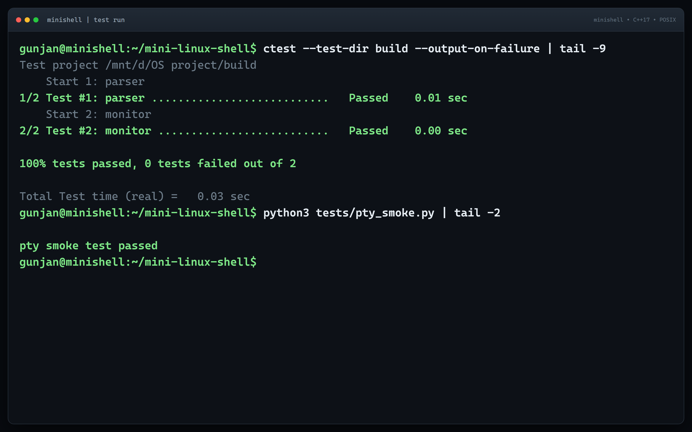

# Test Cases and Results

Environment: WSL2 Ubuntu 24.04, g++ 13.3.0, cmake 3.28.3.
Build: `cmake -S . -B build && cmake --build build -j`.
Manual runs use `./build/minishell` inside a real WSL terminal; scripted runs
pipe commands into the same binary.

## Mandatory checklist

| # | Test | Input | Expected | Result |
|---|---|---|---|---|
| 1 | Basic execution | `ls` | files listed | PASS |
| 2 | Invalid command | `abcxyz` | `No such file or directory`, shell survives | PASS |
| 3 | Directory change | `cd /tmp` then `pwd` | prompt and `pwd` show `/tmp` | PASS |
| 4 | Foreground process | `sleep 2` | shell blocks, then re-prompts | PASS |
| 5 | Background process | `sleep 20 &` | `[1] Started ...`, prompt returns immediately | PASS |
| 6 | Job listing | `jobs` | `[1] Running sleep 20 & PID: ...` | PASS |
| 7 | Process termination | `kill <pid>` | `sent signal 15 to <pid>`; job disappears | PASS |
| 8 | Output redirection | `ls > out.txt` | file contains listing, nothing on terminal | PASS |
| 9 | Input redirection | `cat < out.txt` | file printed | PASS |
| 10 | Append redirection | `echo hi >> out.txt` | line appended, old content kept | PASS |
| 11 | Pipe | `ls \| grep CMake` | filtered output | PASS |
| 12 | Interrupt | Ctrl+C on `sleep 30` | sleep stops, shell re-prompts, `echo survived` works | PASS (pty test) |
| 13 | Stop | Ctrl+Z on `sleep 30` | `[1] Stopped ...`, job listed as Stopped | PASS (pty test) |
| 14 | Resume | `bg 1`, then `fg 1` | Running, then foreground, Ctrl+C works again | PASS (pty test) |
| 15 | Monitoring | `monitor` | table with PID/PPID/STATE/RSS/COMMAND | PASS |
| 16 | Clean exit | `exit` with bg jobs | shell exits, jobs get `SIGHUP` | PASS |

## Edge cases

| Case | Input | Result |
|---|---|---|
| Empty command | just Enter | PASS, new prompt, nothing executed |
| Multiple spaces | `   ls    -l   ` | PASS, parsed as `ls -l` |
| Quoted arguments | `echo "Hello World"` | PASS, single argument |
| Command with no args | `pwd` | PASS |
| Missing input file | `cat < /nonexistent` | PASS, `minishell: /nonexistent: No such file or directory` |
| Invalid PID | `pinfo $$` (no expansion, parses as 0) | PASS, `no such process: 0` |
| Multiple background jobs | `sleep 5 & sleep 6 &` on two lines | PASS, ids 1 and 2 |
| Child exits before `jobs` | `sleep 0.2 &` then idle | PASS, `[1] Done` notice at the prompt |
| Pipe with invalid command | `ls \| abcxyz` | PASS, stage error printed, exit 127 |
| Interrupted syscalls | Ctrl+C while shell waits | PASS, `select`/`waitpid` retry on `EINTR` |
| Exit with background jobs | `sleep 30 &` then `exit` | PASS, job receives `SIGHUP` |
| Unterminated quote | `echo "oops` | PASS, `unterminated quote` |
| Dangling pipe | `ls \|` | PASS, `syntax error near '|'` |
| Redirection without file | `ls >` | PASS, `missing filename after '>'` |
| `&` mid-line | `sleep 1 & echo hi` | PASS, rejected with clear message |
| History recall | `echo first`, `!1` | PASS, entry re-executed and echoed |
| Missing history entry | `!99` | PASS, `!99: event not found` |
| History index overflow | `!99999999999999999999` | PASS, `event not found`, no crash |
| Background pipeline group | `sleep 30 \| sleep 40 &`, then `kill %1` | PASS, both stages share one pgid and die together |
| Builtin in pipeline | `history \| wc -l` | known limitation: `execvp("history")` fails |
| Builtin redirection | `jobs > f` | known limitation: output stays on the terminal |
| Overflowing pid argument | `pinfo 99999999999999999999` | PASS, `pinfo: invalid pid` |
| bash-style signal | `kill -9 %1`, `kill -KILL 4210` | PASS, prefix accepted |
| Stderr redirection | `ls 2> err.txt` | known limitation: `2` is an argument, stdout redirected |
| Backslash escaping | `echo a\ b` | known limitation: backslash is literal outside quotes |

## Automated tests

| Test | Command | Result |
|---|---|---|
| Parser unit tests (12 cases) | `./build/parser_tests` | PASS |
| `/proc` parser + live pid | `./build/monitor_tests` | PASS |
| Ctrl+C / Ctrl+Z / jobs / bg / fg / `!` overflow | `python3 tests/pty_smoke.py` | PASS |
| Zombie check | `sleep 0.2 &`, idle 1.2 s, `ps --ppid <shell>` | no children left |
| fd leak check | 15x `ls \| wc -l`, compare `/proc/<shell>/fd` | 7 before, 7 after |
| Clean rebuild | delete `build/`, rerun cmake + make | PASS, no warnings |

## Screenshot

Captured from a local `ctest` run and `tests/pty_smoke.py`. The full set of
session images is indexed in [demo_script.md](demo_script.md).

## Notes

- Ctrl+C/Ctrl+Z require a real terminal; they are driven through a pseudo
  terminal in `tests/pty_smoke.py`. Piped stdin disables terminal job control by
  design.
- `monitor` output includes every process the user may read. In WSL2 the user
  can read all of them.
- CPU time shown by `pinfo` is cumulative (`utime + stime`); the `CPU now` line
  is a 200 ms two-sample percentage.
